## Featured projects

[Try the demo](https://soundsight-ran-nope.streamlit.app/)

[Try the demo](https://ran-nope.github.io/api-cinema/)

[Open app](https://internship-tracker-seven-alpha.vercel.app)

[Open notebook](https://colab.research.google.com/drive/1pPh43M59JUzmIp6kPgybzvLeL_mE0lCg)

## Find me

[LinkedIn](https://www.linkedin.com/in/kavin-m-159511381/) · [GitHub activity](https://github.com/ran-nope#js-contribution-activity)

