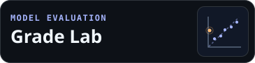

I am an AI & Data Science undergraduate at Kumaraguru College of Technology building applied ML evaluation tools and full-stack web apps.
My core stack is Python, scikit-learn, FastAPI, React, PostgreSQL, and Streamlit; I am seeking ML/Data Science and full-stack engineering internships.

 

 

| Project | Problem Solved | Engineering Evidence | Live Demo |
|---|---|---|---|
| [Grade Lab](https://github.com/ran-nope/grade-lab) | Examine grade prediction and hidden errors | Training-only selection, baselines, bootstrap and regression tests | [Streamlit](https://grade-lab-ran-nope.streamlit.app/) |
| [SoundSight](https://github.com/ran-nope/SoundSight) | Classify environmental sounds | Source-isolated folds, shared preprocessing, auditable metrics | [Streamlit](https://soundsight-ran-nope.streamlit.app/) |
| [Internship Tracker](https://github.com/ran-nope/internship-tracker) | Organize internship applications | Account-isolated CRUD, migrations, API and browser tests | [Application](https://internship-tracker-seven-alpha.vercel.app) |
| [API Cinema](https://github.com/ran-nope/api-cinema) | Learn HTTP through guided experiments | Service-worker API, request validators, automated tests | [Playground](https://ran-nope.github.io/api-cinema/) |

[LinkedIn](https://www.linkedin.com/in/kavin-m-159511381/)
